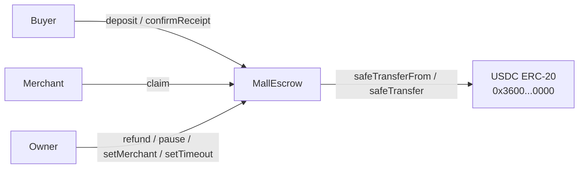
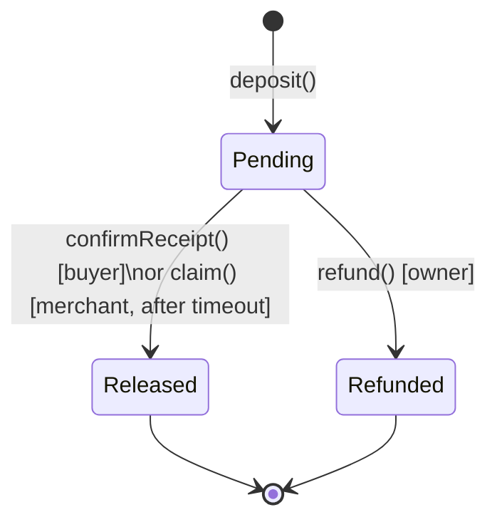
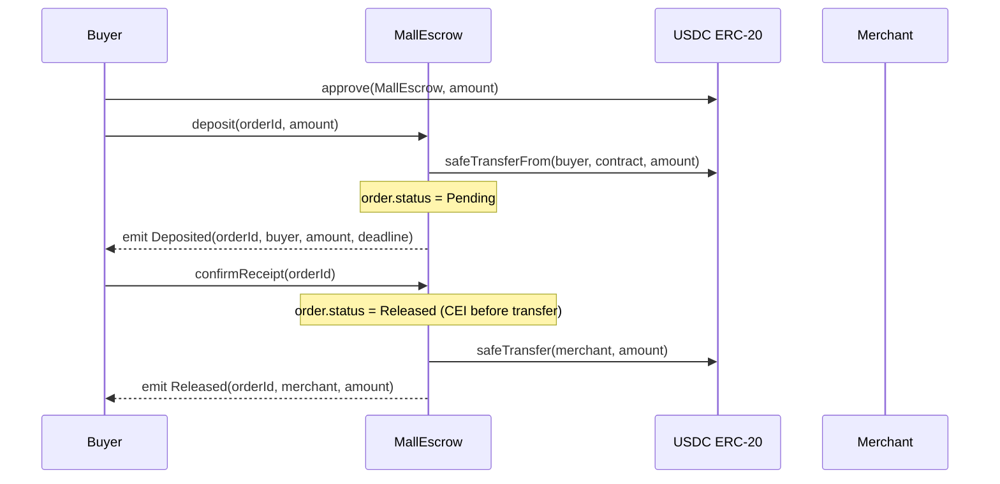
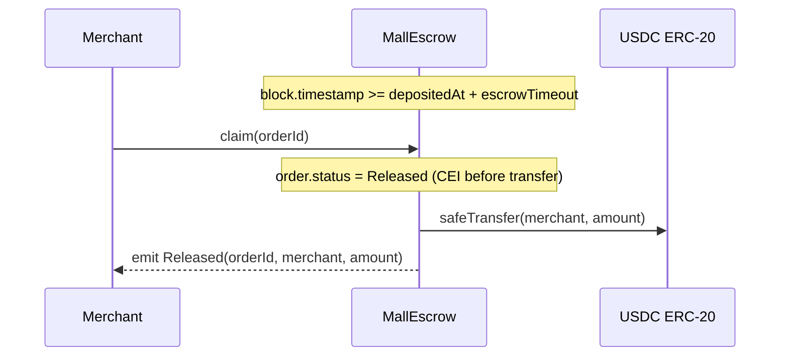

# MallEscrow — Smart-Contract Design Doc

---

## 1. Metadata

| Field | Value |
|---|---|
| **Status** | Draft |
| **Authors** | TBD |
| **Target chain** | Arc Testnet (chain ID 5042002) |
| **Language / Toolchain** | Solidity 0.8.24 · Foundry (forge 0.2.x) |
| **Milestone** | v1.0 — initial escrow for virtual shopping mall |
| **USDC contract** | `0x3600000000000000000000000000000000000000` (Arc Testnet ERC-20, 6 decimals) |

### Review Tracker

| Review | Owner | Ticket | Closed |
|---|---|---|---|
| Design | TBD | TBD | ☐ |
| Security | TBD | TBD | ☐ |
| Ops | TBD | TBD | ☐ |
| Compliance | TBD | TBD | ☐ |

---

## 2. Action Items (living)

_Starts empty. Populated with open items discovered during each review round._

- [ ] Confirm whether `merchant` address should be set per-order or globally.  
- [ ] Confirm default timeout value (7 days proposed; confirm with product team).  
- [ ] Decide whether `refund` should emit a distinct `Refunded` event or re-use a generic fund-movement event.  
- [ ] Confirm whether Rescuable (mistakenly-sent token recovery) is in scope for v1.

---

## 3. Goals / Non-Goals

### Goals

- Hold a buyer's USDC in escrow after an order is placed, releasing funds to the merchant only upon confirmed delivery or timeout expiry.
- Allow the owner to issue refunds as a dispute-resolution mechanism.
- Allow the owner to pause new deposits without disrupting in-flight escrows.
- Be immutable after deployment; no proxy or upgrade mechanism.
- Interact with USDC exclusively via the ERC-20 interface — never via Arc's native gas layer.

### Non-Goals

- Revenue or fee splitting between multiple parties (future feature).
- Multi-merchant routing (single `merchant` address per contract deployment).
- Any use of Arc's native USDC gas token at the EVM level (no `msg.value` handling).
- Upgradeability or migration; new versions = new deployments.
- Blocklisting of buyer or merchant addresses.
- Cross-chain operations of any kind.
- Off-chain signature-based authorisation (EIP-712 / Permit2).

---

## 4. Requirements

### Functional Requirements

| ID | Requirement |
|---|---|
| F-01 | A buyer can deposit a positive USDC amount for a unique `orderId`, transferring USDC from the buyer to the contract. |
| F-02 | Only the buyer who made the deposit for a given `orderId` can confirm receipt for that order. |
| F-03 | Confirming receipt immediately releases the escrowed USDC to the `merchant` address. |
| F-04 | After the configurable timeout has elapsed without confirmation, the `merchant` can call `claim` to receive the USDC. |
| F-05 | The `owner` can call `refund` on any order to return USDC to the original buyer (dispute resolution). |
| F-06 | Each `orderId` is used exactly once; attempting to re-use one reverts. |
| F-07 | The `owner` can pause and unpause new deposits. |
| F-08 | Pausing only blocks `deposit`; active escrows can still be confirmed, claimed, or refunded. |
| F-09 | The `owner` can update the `merchant` address (but not to the zero address). |
| F-10 | The `owner` can update the `escrowTimeout` value (bounded by a minimum and maximum). |
| F-11 | Two-step ownership transfer: the current owner proposes, the new owner accepts. |

### Security Requirements

| ID | Requirement |
|---|---|
| S-01 | No code path allows a caller other than the original depositing buyer to confirm receipt for an order. |
| S-02 | No code path allows funds to be moved on an order whose state is not `Pending`. |
| S-03 | No code path allows reentrancy to manipulate escrow balances or order state. |
| S-04 | Every external USDC transfer uses `SafeERC20`; failures revert the transaction. |
| S-05 | The `merchant` address cannot be set to `address(0)`. |
| S-06 | A duplicate `orderId` deposit always reverts. |
| S-07 | The `claim` path only succeeds if `block.timestamp >= order.depositedAt + escrowTimeout`. |
| S-08 | The `refund` path is restricted to the `owner` and cannot be called on a non-Pending order. |
| S-09 | No unchecked arithmetic on fund amounts. |
| S-10 | USDC transferred via `deposit` is measured by balance-delta (actual received) rather than the `amount` argument, guarding against non-standard transfer implementations. |

---

## 5. Terminology & Actors

### Glossary

| Term | Definition |
|---|---|
| **Order** | A single purchase event identified by a `bytes32 orderId`. Lifecycle: Created → Pending → Released/Refunded. |
| **Escrow** | The `amount` of USDC held by the contract on behalf of a buyer for a specific order. |
| **Timeout** | The `escrowTimeout` value (in seconds) after which an unconfirmed order can be claimed by the merchant. |
| **Deposit** | Buyer's act of locking USDC into the contract for an order. |
| **Confirm** | Buyer's act of acknowledging receipt, releasing USDC to the merchant. |
| **Claim** | Merchant's act of pulling USDC after timeout, without buyer confirmation. |
| **Refund** | Owner's act of returning USDC to the buyer (dispute resolution). |
| **Paused** | Contract state in which new `deposit` calls revert; all other operations proceed normally. |

### Actors

| Actor | On/Off-chain | Trust Level | What They Can Do |
|---|---|---|---|
| `owner` | Off-chain EOA (or multisig) | **Trusted** | Update `merchant` address; update `escrowTimeout`; pause/unpause deposits; refund any order; initiate two-step ownership transfer. Cannot directly access escrowed funds except via `refund`. |
| `merchant` | Off-chain EOA or contract | **Semi-trusted** | Call `claim` after timeout to receive released funds. Cannot access funds before timeout without buyer confirmation. |
| `buyer` | Off-chain EOA or contract | **Untrusted** | Call `deposit` to lock USDC; call `confirmReceipt` to release to merchant. |
| `contract` | On-chain | — | Custodian: holds buyer USDC between `deposit` and release; enforces all state transitions. |

---

## 6. Language / Runtime

| Attribute | Value | Rationale |
|---|---|---|
| **Language** | Solidity 0.8.24 | Checked arithmetic by default (no overflow/underflow); broad tooling support. |
| **Compiler** | Locked to `0.8.24` in `foundry.toml` | Prevents toolchain drift between dev, CI, and deploy. |
| **Toolchain** | Foundry (forge, cast, anvil) | Industry-standard EVM dev framework with built-in fuzz testing and Slither integration. |
| **EVM hardfork target** | Shanghai | Available on Arc Testnet; enables `PUSH0` opcode. No Cancun-specific opcodes (transient storage, blobs) are required. |
| **Base contracts** | OpenZeppelin Contracts 5.x | `Ownable2Step`, `Pausable`, `ReentrancyGuard`, `SafeERC20` — all audited, minimal, composable. |
| **OZ changes** | None. Used as-is (no fork). | Preserves auditability of dependency. |

---

## 7. Transaction & Execution Model

Execution on Arc Testnet is single-transaction atomic: all state changes commit together or the entire transaction reverts. There is no async message-passing or multi-step execution across blocks within a single logical call.

### Reentrancy Surface

All four fund-movement functions (`confirmReceipt`, `claim`, `refund`, `deposit`) call `safeTransferFrom` / `safeTransfer` on the USDC ERC-20 contract. While the canonical USDC implementation is not reentrant, the design makes no assumption about this.

**CEI discipline is applied throughout:**

1. **Check**: validate caller, order state, and timing conditions.
2. **Effect**: update order state (`order.status = Released` or `Refunded`) before any external call.
3. **Interact**: call `USDC.safeTransfer` after state is committed.

Additionally, all fund-movement functions carry the `nonReentrant` modifier from OpenZeppelin's `ReentrancyGuard` as a defense-in-depth measure.

`deposit` also applies CEI: the order record is written (`order.status = Pending`) before the `safeTransferFrom` call. The actual received amount is measured as a balance delta after the transfer to handle any non-standard USDC behaviour.

---

## 8. Chain Standards & Interfaces

### Token Standard

`MallEscrow` interacts with USDC as a standard ERC-20 (`IERC20`) using OpenZeppelin's `SafeERC20` wrapper. No ERC-777, ERC-1363, or Permit extensions are used.

The USDC ERC-20 address on Arc Testnet is `0x3600000000000000000000000000000000000000` (6 decimals). This is distinct from Arc's native gas token (also USDC but at 18 decimals). The contract interacts **only** with the 6-decimal ERC-20; `msg.value` is never read and the contract has no `receive` or `fallback` function.

### Arc Testnet — EVM Role/Interface Mapping

`MallEscrow` is a bespoke escrow, not a port of a known EVM baseline spec. The mapping table below covers roles as they exist in this design:

| Role | Ability | EVM Implementation | Notes |
|---|---|---|---|
| `owner` | Update merchant, timeout, pause, refund, two-step transfer | `Ownable2Step` | Multisig recommended for production |
| `merchant` | Claim after timeout | Stored address, checked in `claim` | Cannot be zero address |
| `buyer` | Deposit, confirm | Stored per-order, checked in `confirmReceipt` | No special interface |
| `pauser` | Pause/unpause deposits | Collapsed into `owner` (v1) | Could be separated in v2 |

> **Note:** The Pauser role is not separated from owner in v1 (see §19 Priorities & Tradeoffs). This is a known simplification.

---

## 9. Architecture Overview

### Component Diagram



### Order Lifecycle (State Machine)



### Sequence Diagram — Happy Path



### Sequence Diagram — Timeout Claim



### Flow of Funds

| Step | Who moves what | Invariant that must hold |
|---|---|---|
| `deposit` | Buyer → Contract: `amount` USDC | `contract.balance(USDC) += amount`; order status = Pending |
| `confirmReceipt` | Contract → Merchant: `amount` USDC | `contract.balance(USDC) -= amount`; order status = Released |
| `claim` (timeout) | Contract → Merchant: `amount` USDC | `block.timestamp ≥ depositedAt + escrowTimeout`; order status = Released |
| `refund` | Contract → Buyer: `amount` USDC | Owner-authorised only; order status = Refunded |

**Resting-state invariant:** `sum(orders[x].amount for all x where orders[x].status == Pending) == contract's USDC ERC-20 balance`

### External Dependencies

| Dependency | Address | Assumption |
|---|---|---|
| USDC ERC-20 on Arc Testnet | `0x3600000000000000000000000000000000000000` | Non-reentrant; standard ERC-20 transfer semantics; 6 decimals |
| Arc Testnet RPC | `https://rpc.testnet.arc.io` | EVM-compatible; Shanghai hardfork |

---

## 10. Contract Design

### Roles

| Role | Count / Holder | Permissions | Rationale |
|---|---|---|---|
| `owner` | 1 (deployer; two-step transfer) | `setMerchant`, `setEscrowTimeout`, `pause`, `unpause`, `refund`, `acceptOwnership`, `transferOwnership` | Top-level admin. Must never be the zero address. Multisig recommended. |
| `merchant` | 1 (stored address; updatable by owner) | `claim` (after timeout) | Recipient of released funds. Separated from owner so the payment address can be a hot wallet without owner privileges. |
| `buyer` | N (one per order; determined at deposit time) | `deposit`, `confirmReceipt` (own orders only) | Untrusted. Permissions are per-order, not global. |

### Storage Layout

```solidity
// SPDX-License-Identifier: MIT
// Non-upgradeable — no namespace or __gap needed.

enum OrderStatus { NonExistent, Pending, Released, Refunded }

struct Order {
    address buyer;        // 20 bytes
    uint96  amount;       // 12 bytes  ← packed with buyer in one slot (32 bytes total)
    uint40  depositedAt;  // 5 bytes   ← timestamp; safe until year 36812
    OrderStatus status;   // 1 byte    ← packed with depositedAt
    // 26 bytes used in slot 2; 6 bytes padding
}

// MallEscrow state variables (slot indices are informational; Ownable2Step/Pausable/ReentrancyGuard prepend their own slots)
mapping(bytes32 => Order) public orders;   // orderId → Order
address public merchant;                   // recipient of released funds
uint40  public escrowTimeout;              // seconds; default 7 days = 604800
```

> **Slot packing note:** `buyer` (20 bytes) + `amount` (12 bytes, uint96 supports up to ~79 billion USDC) fit in one 32-byte slot. `depositedAt` (uint40) + `status` (1 byte, enum) + padding fit in a second slot. This reduces SSTORE costs per order.

> **Amount type:** `uint96` safely covers USDC totals up to ~79.2 billion (79,228,162,514 USDC). All external `amount` parameters are cast/validated to `uint96` at deposit time.

### Modifiers

| Modifier | Guard Enforced |
|---|---|
| `onlyOwner` | `msg.sender == owner()` (from `Ownable2Step`) |
| `whenNotPaused` | Deposits revert when paused (from `Pausable`) |
| `nonReentrant` | Reentrancy lock on all fund-movement functions (from `ReentrancyGuard`) |

### Functions — Write

#### `deposit(bytes32 orderId, uint256 amount)`

| Attribute | Value |
|---|---|
| **Caller** | Any address (buyer) |
| **Access** | `whenNotPaused` |
| **State mutated** | Creates `orders[orderId]` with status `Pending`, `buyer = msg.sender`, `amount`, `depositedAt = block.timestamp` |
| **Events** | `Deposited(orderId, buyer, amount, deadline)` |
| **Reverts** | `orders[orderId].status != NonExistent` (duplicate orderId); `amount == 0`; `amount > type(uint96).max`; `safeTransferFrom` fails; received delta != amount (fee-on-transfer guard) |

```
Pre: contract not paused; orderId not previously used; amount > 0
  balanceBefore = USDC.balanceOf(address(this))
  orders[orderId] = Order(msg.sender, uint96(amount), block.timestamp, Pending)   // Effect first
  USDC.safeTransferFrom(msg.sender, address(this), amount)                         // Then Interact
  require(USDC.balanceOf(address(this)) - balanceBefore == amount)                 // Delta check
  emit Deposited(orderId, msg.sender, amount, block.timestamp + escrowTimeout)
```

#### `confirmReceipt(bytes32 orderId)`

| Attribute | Value |
|---|---|
| **Caller** | The buyer recorded for `orderId` |
| **Access** | `nonReentrant` |
| **State mutated** | `orders[orderId].status = Released` |
| **Events** | `Released(orderId, merchant, amount)` |
| **Reverts** | `orders[orderId].status != Pending`; `msg.sender != orders[orderId].buyer` |

```
Pre: order.status == Pending; msg.sender == order.buyer
  order.status = Released          // Effect before interact (CEI)
  USDC.safeTransfer(merchant, order.amount)
  emit Released(orderId, merchant, order.amount)
```

#### `claim(bytes32 orderId)`

| Attribute | Value |
|---|---|
| **Caller** | `merchant` |
| **Access** | `nonReentrant` |
| **State mutated** | `orders[orderId].status = Released` |
| **Events** | `Released(orderId, merchant, amount)` |
| **Reverts** | `msg.sender != merchant`; `orders[orderId].status != Pending`; `block.timestamp < orders[orderId].depositedAt + escrowTimeout` |

```
Pre: order.status == Pending; msg.sender == merchant; block.timestamp >= depositedAt + escrowTimeout
  order.status = Released          // Effect before interact (CEI)
  USDC.safeTransfer(merchant, order.amount)
  emit Released(orderId, merchant, order.amount)
```

#### `refund(bytes32 orderId)`

| Attribute | Value |
|---|---|
| **Caller** | `owner` |
| **Access** | `onlyOwner`, `nonReentrant` |
| **State mutated** | `orders[orderId].status = Refunded` |
| **Events** | `Refunded(orderId, buyer, amount)` |
| **Reverts** | `orders[orderId].status != Pending` |

```
Pre: onlyOwner; order.status == Pending
  order.status = Refunded          // Effect before interact (CEI)
  USDC.safeTransfer(order.buyer, order.amount)
  emit Refunded(orderId, order.buyer, order.amount)
```

#### `setMerchant(address newMerchant)`

| Attribute | Value |
|---|---|
| **Caller** | `owner` |
| **Access** | `onlyOwner` |
| **State mutated** | `merchant = newMerchant` |
| **Events** | `MerchantUpdated(oldMerchant, newMerchant)` |
| **Reverts** | `newMerchant == address(0)` |

#### `setEscrowTimeout(uint40 newTimeout)`

| Attribute | Value |
|---|---|
| **Caller** | `owner` |
| **Access** | `onlyOwner` |
| **State mutated** | `escrowTimeout = newTimeout` |
| **Events** | `EscrowTimeoutUpdated(oldTimeout, newTimeout)` |
| **Reverts** | `newTimeout < MIN_TIMEOUT` (e.g. 1 hour = 3600) or `newTimeout > MAX_TIMEOUT` (e.g. 90 days = 7776000) |
| **Note** | Only affects orders created **after** the update; existing orders use the timeout value captured at deposit time. |

> **Important:** `escrowTimeout` changes must not retroactively affect pending orders. The `deadline` is fixed at deposit time and stored (or computed from the stored `depositedAt`). The `claim` check uses `order.depositedAt + escrowTimeout_at_deposit_time`. Implementation options: (a) store the effective deadline in the `Order` struct, or (b) snapshot timeout at deposit. Approach (a) is simpler and gas-efficient — the `depositedAt` field stores the timestamp; `claim` compares against `depositedAt + escrowTimeout` where `escrowTimeout` is the **current** global value. This means an owner reducing the timeout could accelerate claims on pending orders — see §19 Priorities & Tradeoffs.

#### `pause()` / `unpause()`

| Attribute | Value |
|---|---|
| **Caller** | `owner` |
| **Access** | `onlyOwner` |
| **State mutated** | `_paused` (OZ Pausable) |
| **Events** | `Paused(account)` / `Unpaused(account)` |
| **Effect** | `pause` blocks new `deposit` calls; all other functions unaffected. |

#### `transferOwnership(address newOwner)` / `acceptOwnership()`

Inherited from `Ownable2Step`. `transferOwnership` is `onlyOwner` and nominates a pending owner; `acceptOwnership` is called by the pending owner to complete the transfer. `renounceOwnership` is **disabled** (overridden to revert) — the contract must always have an owner.

### Functions — Read

- `getOrder(bytes32 orderId) returns (Order memory)` — returns full order struct.
- `isClaimable(bytes32 orderId) returns (bool)` — returns true if `status == Pending && block.timestamp >= depositedAt + escrowTimeout`.
- `owner()`, `merchant()`, `escrowTimeout()`, `paused()` — standard view accessors.

### Events

| Event | Parameters | When Emitted |
|---|---|---|
| `Deposited` | `bytes32 indexed orderId, address indexed buyer, uint256 amount, uint256 claimDeadline` | Successful deposit |
| `Released` | `bytes32 indexed orderId, address indexed merchant, uint256 amount` | `confirmReceipt` or `claim` succeeds |
| `Refunded` | `bytes32 indexed orderId, address indexed buyer, uint256 amount` | `refund` succeeds |
| `MerchantUpdated` | `address indexed oldMerchant, address indexed newMerchant` | `setMerchant` succeeds |
| `EscrowTimeoutUpdated` | `uint40 oldTimeout, uint40 newTimeout` | `setEscrowTimeout` succeeds |
| `Paused` | `address account` | Inherited from OZ Pausable |
| `Unpaused` | `address account` | Inherited from OZ Pausable |
| `OwnershipTransferStarted` | `address indexed previousOwner, address indexed newOwner` | Inherited from Ownable2Step |
| `OwnershipTransferred` | `address indexed previousOwner, address indexed newOwner` | Inherited from Ownable2Step |

> **Indexing rationale:** `orderId` and `buyer`/`merchant` are indexed to allow off-chain monitoring to filter by order or address efficiently.

---

## 11. Specification Tables per Feature Area

### 11.1 — Escrow Core

**Invariants:**
1. `sum(amount for all Pending orders) == contract's USDC ERC-20 balance` at all times.
2. An order's `status` transitions only forward: `NonExistent → Pending → {Released | Refunded}`. No backward transitions.
3. Only the address stored as `order.buyer` can call `confirmReceipt` for that order.
4. A `Released` or `Refunded` order can never have funds moved again.
5. The contract never holds more USDC than the sum of all Pending order amounts (excess would indicate a fee-on-transfer or donation; the delta check in `deposit` prevents under-reporting).

**Functionalities:**

| Functionality | Restriction | Note | Event | Audit/Verify Note |
|---|---|---|---|---|
| Deposit USDC | Any address; not paused; orderId unused; amount > 0 | Amount stored as received delta | `Deposited` | Verify delta check prevents amount inflation |
| Confirm receipt | Only the depositing buyer; order Pending | Releases to merchant immediately | `Released` | Verify `msg.sender == order.buyer` check |
| Claim after timeout | Only merchant; order Pending; past deadline | Uses `block.timestamp`; tolerance ±15 s acceptable | `Released` | Verify timeout boundary (exact second) |
| Refund | Only owner; order Pending | Dispute resolution, no time constraint | `Refunded` | Verify only Pending orders are refundable |

### 11.2 — Pause

**Invariants:**
1. When paused, `deposit` always reverts.
2. When paused, `confirmReceipt`, `claim`, and `refund` proceed normally.

| Functionality | Restriction | Note | Event |
|---|---|---|---|
| Pause deposits | Only owner | Does not affect in-flight orders | `Paused` |
| Unpause deposits | Only owner | Restores deposit capability | `Unpaused` |

### 11.3 — Admin Config

**Invariants:**
1. `merchant` is never `address(0)` after deployment.
2. `escrowTimeout` is always within `[MIN_TIMEOUT, MAX_TIMEOUT]`.

| Functionality | Restriction | Note | Event |
|---|---|---|---|
| Set merchant address | Only owner; non-zero | Affects all future releases | `MerchantUpdated` |
| Set escrow timeout | Only owner; within bounds | Affects future orders; current-order semantics in §10 | `EscrowTimeoutUpdated` |

---

## 12. Deployment & Initialization

### Constructor Parameters

```solidity
constructor(
    address _usdc,          // USDC ERC-20 on Arc Testnet: 0x3600000000000000000000000000000000000000
    address _merchant,      // must be non-zero; semi-trusted
    uint40  _escrowTimeout, // seconds; recommended default: 604800 (7 days)
    address _owner          // deployer or multisig; receives Ownable2Step ownership
)
```

### Init Runbook

| Step | Who | Action |
|---|---|---|
| 1 | Deployer | Compile with locked Solidity 0.8.24 (`forge build`) |
| 2 | Deployer | Deploy `MallEscrow(usdcAddress, merchantAddress, 604800, ownerAddress)` via `forge create` or Circle SCP |
| 3 | Deployer | Verify constructor args on-chain (Arc Testnet explorer: `https://explorer.testnet.arc.io`) |
| 4 | Deployer | Call `getOrder(bytes32(0))` to confirm `status == NonExistent` (sanity check) |
| 5 | Owner | If owner ≠ deployer: `transferOwnership(ownerAddress)` then new owner calls `acceptOwnership()` |
| 6 | Ops | Wire monitoring alerts to `Deposited`, `Released`, `Refunded` events |

### Post-Deploy Minimum Balance

The deploying wallet needs only enough USDC gas to cover deployment. The contract itself holds zero USDC at rest (no pre-funding required).

### Key Roles at Genesis

| Role | Address | Key Type |
|---|---|---|
| `owner` | Deployer (or designated multisig) | Cold/multisig recommended |
| `merchant` | Merchant hot wallet | Hot wallet |

---

## 13. Upgradeability

**N/A — immutable contract.** No proxy. No `initialize` function.

**Migration story:** When a new version is needed, deploy a new `MallEscrow` contract at a new address. Existing orders on the old contract complete normally (buyers can still `confirmReceipt`; merchant can still `claim`; owner can still `refund`). The application layer (frontend / backend) is updated to direct new orders to the new contract address. Old contract can be paused to block new deposits while existing orders drain. No dual-run coordination needed beyond the frontend update.

---

## 14. Key Management & Signing

### Role Key Requirements

| Role | Recommended Key Type | Rationale |
|---|---|---|
| `owner` | Multisig (≥2-of-3) | Holds pause + refund power; compromise = griefing risk |
| `merchant` | Hot EOA acceptable | Receives funds; no privileged write access |
| `buyer` | End-user wallet (EOA or smart account) | Per-order; no privileged access beyond own orders |

### Signing

No off-chain signatures are used in v1. All authorizations are on-chain (`msg.sender` checks). No EIP-712 structured data, no Permit2, no EIP-1271 contract-account signing.

**Replay protection:** Not applicable — no signature-based authorization.

**Future consideration:** EIP-712 `depositWithPermit` would allow buyers to deposit in a single transaction (permit + deposit), removing the `approve` → `deposit` two-step. Deferred to v2.

---

## 15. Security Considerations

| Vulnerability | Applicable? | Mitigation |
|---|---|---|
| **Reentrancy** | Yes — four external USDC transfer sites | CEI ordering (state committed before every `safeTransfer`/`safeTransferFrom`) + `nonReentrant` modifier on all fund-movement functions |
| **Access control** | Yes — three privileged roles | `onlyOwner` on all admin functions; per-order `buyer` check in `confirmReceipt`; `merchant` address check in `claim`; enumerated in §10 |
| **Integer overflow/underflow** | Low — Solidity 0.8.24 checked by default | No `unchecked` blocks anywhere in fund-movement paths |
| **Unchecked external call / return** | Yes — USDC `transferFrom`/`transfer` | `SafeERC20` wrappers; reverts on non-bool-returning tokens; reverts on false return |
| **Fee-on-transfer / rebasing tokens** | Theoretical — USDC is not fee-on-transfer, but the design guards anyway | Balance-delta check in `deposit`: `require(balanceAfter - balanceBefore == amount)` |
| **Signature replay** | N/A | No off-chain signatures used in v1 |
| **Front-running / MEV** | Low | `orderId` is determined by the application; a front-runner depositing the same `orderId` would be the buyer for that order and bound by its rules. No value extraction path. |
| **Flash-loan / price manipulation** | N/A | No price oracle used |
| **Oracle manipulation** | N/A | No oracle dependency |
| **Denial of service** | Low | Push-based fund release (no loops over unbounded arrays); pull-over-push design for `claim`; no batch operations |
| **Delegatecall / proxy safety** | N/A | No proxy, no delegatecall |
| **Timestamp / block dependence** | Yes — timeout uses `block.timestamp` | Tolerance: miners/validators can shift timestamp by ~15 seconds; this is acceptable for a 7-day timeout window (0.0025% error). Not used for randomness. |
| **Approval persistence** | Yes — buyer must `approve` before `deposit` | Buyers should approve exact amounts, not `type(uint256).max`. Contract does not set approvals on behalf of others. |
| **Centralization risk** | Yes — `owner` can pause deposits and refund orders | Mitigated by two-step ownership (`Ownable2Step`); recommended multisig; `renounceOwnership` disabled; blast radius documented in §16 |
| **Incorrect orderId reuse** | Yes — attacker could try to deposit on a completed orderId | `orders[orderId].status != NonExistent` check reverts any deposit on a non-fresh orderId |
| **Merchant address set to zero** | Yes | `setMerchant` reverts on `address(0)` |
| **Timeout reduced to accelerate claim** | Yes — owner reducing `escrowTimeout` could make pending orders claimable sooner than the buyer expects | See §19 Tradeoffs; mitigated by storing `depositedAt` and applying the current global timeout. A bound on minimum timeout (`MIN_TIMEOUT`) limits the attack surface. Operational controls (multisig ownership, monitoring on `EscrowTimeoutUpdated`) provide additional protection. |

---

## 16. Trust Model & Threat Analysis

### Owner Key Compromised

| Dimension | Detail |
|---|---|
| **Max damage** | Attacker can: (1) refund all Pending orders to buyers (griefing the merchant; funds return to buyers so no direct theft); (2) set `merchant` to attacker's address then wait for buyers to `confirmReceipt` or `claim` (intercepts future fund releases); (3) pause new deposits (service disruption). Cannot steal already-released funds (state is terminal). |
| **Mitigation** | Multisig owner (≥2-of-3); `setMerchant` emits `MerchantUpdated` (monitorable); two-step ownership prevents accidental transfer; response window before existing orders complete. |
| **Detection** | Alert on `MerchantUpdated`, `Paused`, `Refunded` events outside normal operating patterns. |

### Merchant Key Compromised

| Dimension | Detail |
|---|---|
| **Max damage** | Attacker receives released funds (from legitimate `claim` after timeout or buyer `confirmReceipt`). Cannot accelerate claim (timeout enforced on-chain). Cannot access Pending orders before timeout. Cannot pause, refund, or change any configuration. |
| **Mitigation** | Merchant address is updatable by owner; on compromise, owner rotates to a new address before pending orders time out. |
| **Detection** | Alert on unexpected `Released` events routed to a new address; off-chain transaction monitoring on merchant wallet. |

### Buyer Attempts Fraud

| Dimension | Detail |
|---|---|
| **Attack vectors** | (1) Confirm receipt without receiving goods (cheating the merchant — this is a product/legal problem, not a contract vulnerability); (2) Try to `confirmReceipt` on another buyer's order; (3) Try to `refund` directly; (4) Try to re-deposit on a used `orderId`. |
| **Mitigation** | (2) `msg.sender == order.buyer` check; (3) `onlyOwner` on refund; (4) `status == NonExistent` check. (1) is out of scope for the contract. |

### Merchant Claims Too Early

| Dimension | Detail |
|---|---|
| **Max damage** | Merchant calls `claim` before timeout. |
| **Mitigation** | `block.timestamp >= depositedAt + escrowTimeout` enforced on-chain; reverts if not met. |

---

## 17. Emergency Response & Circuit Breakers

### Pause Mechanism

- **Who triggers:** `owner` (calls `pause()`).
- **Effect:** New `deposit` calls revert with `EnforcedPause()`. In-flight orders are unaffected.
- **Restoration:** `owner` calls `unpause()`.
- **Incident playbook:**
  1. Owner (or multisig co-signers) detects anomaly (unusual deposit volume, suspected exploit).
  2. Owner calls `pause()`.
  3. Investigate. Existing Pending orders continue to resolve normally.
  4. If a refund-all is required, owner calls `refund` on each impacted order individually.
  5. Once safe, owner calls `unpause()` or deploys a remediated contract and migrates (see §13).

### Stuck Token Recovery (Rescuable)

In v1, the contract does **not** implement a `Rescuable` / token-rescue function. Because the contract holds real user USDC, a permissionless rescue path would be dangerous. The balance invariant (`sum of Pending order amounts == USDC balance`) means any excess USDC would indicate a fee-on-transfer token (blocked by the delta check) or a direct USDC transfer to the contract address. 

**Recommendation for v2:** Add a `rescueERC20(address token, uint256 amount)` function callable by a separate `Rescuer` role, restricted to tokens that are NOT the USDC contract and to amounts that do not exceed `USDC.balanceOf(address(this)) - sumPendingAmounts`. This is deferred to v1 post-deployment assessment.

### No Rate Limiting

Rate limiting on deposits is not implemented in v1. The owner's pause capability serves as the manual circuit breaker. Automated rate limiting (e.g., max deposits per block) is a v2 consideration.

---

## 18. Failure Scenarios

### Scenario A: `confirmReceipt` Reverts Mid-Flight

The USDC `safeTransfer` to merchant reverts (e.g., merchant address is a contract that rejects ERC-20). Because CEI is applied — `order.status = Released` is written **before** the transfer — the transfer revert causes the entire transaction to revert (EVM atomicity), rolling back the status change. The order remains `Pending`, and the buyer can retry or the owner can `refund`.

**Risk:** If the merchant address is updated to a contract that always reverts on ERC-20 receipt, neither `confirmReceipt` nor `claim` can succeed. Mitigation: `setMerchant` should validate the new address is an EOA or known-good contract; operational monitoring on `MerchantUpdated`.

### Scenario B: `deposit` transferFrom Reverts

`safeTransferFrom` reverts if the buyer has insufficient balance or has not approved the contract. The entire transaction reverts; `orders[orderId]` is written before the transfer (CEI means the state update happens first in the EVM execution). Since the transfer reverts, the transaction is atomically rolled back — the order record is **not** persisted. No funds are moved; no state is changed.

### Scenario C: Owner Key Compromised Before Any Orders

An attacker gains the owner key before any orders are placed. They set `merchant = attackerAddress`. Future `confirmReceipt` and `claim` calls route funds to the attacker. **Detection:** `MerchantUpdated` event. **Response:** If detected quickly (before orders finalize), the legitimate team should use a secondary multisig signer to rotate the merchant address back. If the owner key is fully compromised, no on-chain recovery is possible — underscores multisig requirement.

### Scenario D: Contract Deployed with Wrong USDC Address

Constructor accepts `_usdc` as a parameter. If the wrong address is passed, deposits and releases interact with the wrong token. Orders appear to succeed but USDC is not actually moved. **Mitigation:** Constructor should validate `_usdc != address(0)`; deployment runbook includes post-deploy sanity check (verify token address on explorer). Consider hardcoding the USDC address as a constant for additional safety (no constructor arg, eliminates class of deployment error).

### Scenario E: Merchant Never Claims After Timeout

Merchant is offline or unresponsive. Orders sit `Pending` indefinitely past the timeout. **Effect:** Buyer USDC is held until the merchant comes back and calls `claim`, or until the owner calls `refund`. No automatic timeout-and-refund mechanism. **This is by design.** If automatic refund on double-timeout is desired, it is a v2 feature.

---

## 19. Priorities & Tradeoffs

| Decision | Tradeoff | Rationale |
|---|---|---|
| **No upgradeability** | Cannot patch logic bugs post-deploy; migration requires new address | Eliminates proxy/upgrade attack surface; no storage layout drift risk; simpler audit scope. For a v1 escrow with bounded complexity, immutability is the correct choice. |
| **Single merchant address** | All orders release to the same address; no per-order routing | Simpler, fewer attack surfaces, fewer storage slots. Multi-merchant routing deferred to v2 when requirements are clearer. |
| **Pauser == Owner** | A single key holds both pause and refund power; compromise of owner is higher blast radius | v1 simplification. Separating Pauser reduces owner blast radius and is the recommended Circle convention. Accepted for v1 given multisig owner requirement. |
| **No Rescuable in v1** | Mistakenly-sent tokens other than USDC are permanently locked | Acceptable for v1 given the contract is single-purpose; USDC accounting invariant prevents accidental rescue of escrowed funds. Add Rescuer role in v2. |
| **Timeout applies current global value to all pending orders** | Owner reducing timeout accelerates claim window on existing orders | Simpler storage (no per-order timeout snapshot needed). Bounded by `MIN_TIMEOUT` (1 hour). Owner is trusted (multisig); operational monitoring on `EscrowTimeoutUpdated` provides detection. **Rejected alternative:** Store timeout deadline in Order struct at deposit time — costs 32 extra bytes of storage per order (a full slot) and eliminates the accelerated-claim issue entirely. Recommended if the trust model for owner changes. |
| **uint96 for amount** | Caps single-order USDC at ~79 billion | Enables slot packing with buyer address (saving one SSTORE/SLOAD per order). 79 billion USDC far exceeds any realistic single order. |
| **No `depositWithPermit`** | Two-transaction UX for buyers (approve + deposit) | EIP-712 / Permit2 integration adds complexity and an off-chain signing surface. Deferred to v2. |
| **No automatic refund after double-timeout** | Funds can be held indefinitely if merchant is offline | Keeps the contract simple; owner retains manual refund ability. Auto-refund requires a time-locked secondary claim path and adds complexity. |

---

## 20. Testing Strategy

### Coverage Targets

| Category | Target |
|---|---|
| Line coverage | ≥ 98% |
| Branch coverage | ≥ 95% |
| Function coverage | 100% |

### Unit Tests (Foundry)

Required test cases:

| Test | Assertion |
|---|---|
| `test_deposit_success` | Order created with Pending status, correct buyer/amount/depositedAt, USDC transferred |
| `test_deposit_reverts_duplicate_orderId` | Reverts on second deposit with same orderId |
| `test_deposit_reverts_zero_amount` | Reverts on `amount == 0` |
| `test_deposit_reverts_when_paused` | Reverts when contract is paused |
| `test_confirmReceipt_success` | Order status → Released, USDC transferred to merchant, event emitted |
| `test_confirmReceipt_reverts_wrong_caller` | Non-buyer cannot confirm |
| `test_confirmReceipt_reverts_non_pending` | Released/Refunded order cannot be re-confirmed |
| `test_claim_success` | Merchant claims after timeout; status → Released, USDC transferred |
| `test_claim_reverts_too_early` | Claim before timeout reverts |
| `test_claim_reverts_non_merchant` | Non-merchant cannot claim |
| `test_refund_success` | Owner refunds pending order; status → Refunded; USDC returned to buyer |
| `test_refund_reverts_non_owner` | Non-owner cannot refund |
| `test_refund_reverts_non_pending` | Cannot refund a Released order |
| `test_setMerchant_success` | Merchant updated; event emitted |
| `test_setMerchant_reverts_zero_address` | Reverts on zero address |
| `test_setEscrowTimeout_success` | Timeout updated within bounds; event emitted |
| `test_setEscrowTimeout_reverts_out_of_bounds` | Reverts on < MIN or > MAX |
| `test_pause_blocks_deposit` | Deposit reverts; other functions unaffected |
| `test_ownership_two_step` | `transferOwnership` + `acceptOwnership` flow; direct takeover impossible |
| `test_renounceOwnership_disabled` | `renounceOwnership` reverts |
| `test_resting_state_invariant` | After all operations, contract USDC balance == sum of Pending amounts |

### Fuzz Tests

```solidity
function testFuzz_deposit_and_confirm(bytes32 orderId, uint96 amount, address buyer) external;
// Property: after confirmReceipt, merchant receives exactly `amount` USDC; contract balance decreases by exactly `amount`.

function testFuzz_no_double_release(bytes32 orderId) external;
// Property: a released or refunded order cannot be released or refunded again.

function testFuzz_timeout_boundary(uint40 depositTime, uint40 timeout, uint40 claimTime) external;
// Property: claim reverts iff claimTime < depositTime + timeout.
```

### Invariant Tests

```solidity
// Invariant: contract USDC balance >= sum of all Pending order amounts (never less)
function invariant_usdc_balance_covers_pending_orders() external;

// Invariant: no order ever has status > Refunded (enum bounds)
function invariant_order_status_valid() external;
```

### Static Analysis

```bash
forge build && slither contracts/MallEscrow.sol \
  --checklist \
  --filter-paths "lib/" \
  --solc-remaps "@openzeppelin/=lib/openzeppelin-contracts/"
```

Merge gate: zero High or Medium findings from Slither.

### Run Full Suite

```bash
forge test --match-path "test/MallEscrow*" -vvv
forge coverage --match-path "test/MallEscrow*" --report lcov
slither contracts/MallEscrow.sol
```

---

## 21. Third-Party Libraries

| Library | Version | Already a Dependency? | Why Chosen | Security Reviewed? |
|---|---|---|---|---|
| `openzeppelin-contracts` | 5.x (pin exact, e.g. `5.0.2`) | To be confirmed | `Ownable2Step`, `Pausable`, `ReentrancyGuard`, `SafeERC20` — battle-tested, minimal, composable. | Yes — OpenZeppelin contracts are continuously audited; each release has an accompanying audit report. |
| `forge-std` | 1.x | Yes (Foundry built-in) | Test utilities (`Test`, `console2`, `StdAssertions`, `StdCheats`) | Yes — Foundry standard library |

---

## 22. Monitoring & Alerting

| Event / Metric | Threshold / Condition | Severity | Playbook |
|---|---|---|---|
| `Deposited` | Any emission | Info | Log order; start expiry timer in off-chain tracker |
| `Released` | Any emission | Info | Mark order fulfilled; notify buyer/merchant |
| `Refunded` | Any emission | Warning | Investigate dispute; log reason |
| `MerchantUpdated` | Any emission outside normal business hours or unexpected address | High | Verify with owner; if unauthorized, rotate merchant immediately |
| `Paused` | Any emission | High | Trigger incident response; investigate cause |
| `EscrowTimeoutUpdated` | Any emission | Medium | Verify intentional; check impact on pending orders |
| `OwnershipTransferStarted` | Any emission | High | Confirm with new owner; verify no unauthorized transfer |
| `OwnershipTransferred` | Any emission | Critical | Verify authorized; alert all stakeholders |
| Contract USDC balance drops below sum of Pending amounts | Any | Critical | Immediate investigation; indicates invariant violation |
| Pending order age > `escrowTimeout + 1 hour` and not claimed | Per order | Low | Notify merchant to claim; or owner to investigate |

---

## 23. Cross-Functional Stakeholders

| Stakeholder | Review Owns |
|---|---|
| **Smart Contract Author** | Code correctness against this spec |
| **Security Reviewer** | §15 Security table, §16 Threat model, §18 Failure scenarios; sign-off required before deploy |
| **Product / Design** | §3 Goals/Non-Goals, §4 Functional requirements, §19 Tradeoffs |
| **Operations** | §12 Deployment runbook, §17 Emergency response, §22 Monitoring |
| **Legal / Compliance** | §3 Non-Goals (revenue splitting, dispute resolution scope), owner refund authority |

---

## 24. Message Encoding

**N/A** — `MallEscrow` is a single-chain contract on Arc Testnet. No cross-chain messages are sent or received.

---

## 25. Types & Enums

```solidity
/// @notice Lifecycle states for an escrow order.
enum OrderStatus {
    NonExistent,  // 0 — default (uninitialized); orderId has never been deposited
    Pending,      // 1 — USDC held in escrow; awaiting confirmation or timeout
    Released,     // 2 — USDC released to merchant (via confirmReceipt or claim)
    Refunded      // 3 — USDC returned to buyer (via owner refund)
}

/// @notice On-chain record for a single escrow order.
struct Order {
    address     buyer;        // Address that deposited; only they can confirmReceipt
    uint96      amount;       // USDC amount (6 decimals); max ~79.2B USDC
    uint40      depositedAt;  // block.timestamp at deposit; safe until year 36,812
    OrderStatus status;       // Current lifecycle state
}
```

---

## 26. Common Patterns / Worked Examples

### Example A — Full Happy Path (Buyer Confirms Receipt)

**Actors:** Buyer `0xBuyer`, Merchant `0xMerchant`, Owner `0xOwner`  
**Order:** `orderId = keccak256("order-42")`, `amount = 100_000_000` (100 USDC, 6 decimals)

| Step | Call | State Before | State After | Events |
|---|---|---|---|---|
| 1 | `USDC.approve(MallEscrow, 100_000_000)` from `0xBuyer` | Buyer USDC: 200 USDC | Allowance: 100 USDC | *(ERC-20 Approval)* |
| 2 | `MallEscrow.deposit(orderId, 100_000_000)` from `0xBuyer` | `orders[orderId].status = NonExistent`; Contract USDC: 0 | `orders[orderId] = {buyer: 0xBuyer, amount: 100e6, depositedAt: T, status: Pending}`; Contract USDC: 100 | `Deposited(orderId, 0xBuyer, 100e6, T+604800)` |
| 3 | `MallEscrow.confirmReceipt(orderId)` from `0xBuyer` | `status = Pending`; Merchant USDC: 0 | `status = Released`; Merchant USDC: 100; Contract USDC: 0 | `Released(orderId, 0xMerchant, 100e6)` |

**End state:** Order Released. Resting-state invariant holds (0 Pending USDC, 0 contract balance).

---

### Example B — Timeout Claim + Dispute Refund

**Setup:** Same order as above. Buyer deposits but never confirms receipt. 7 days pass.

| Step | Call | State Before | State After | Events |
|---|---|---|---|---|
| 1 | *(7 days elapse; `block.timestamp >= depositedAt + 604800`)* | `status = Pending` | — | — |
| 2 | `MallEscrow.claim(orderId)` from `0xMerchant` | `status = Pending`; Merchant USDC: 0 | `status = Released`; Merchant USDC: 100; Contract USDC: 0 | `Released(orderId, 0xMerchant, 100e6)` |

**Alternate path (dispute):** Before step 2, buyer raises a dispute.

| Step | Call | State Before | State After | Events |
|---|---|---|---|---|
| 2a | `MallEscrow.refund(orderId)` from `0xOwner` | `status = Pending`; Buyer USDC: 100 less | `status = Refunded`; Buyer USDC: restored; Contract USDC: 0 | `Refunded(orderId, 0xBuyer, 100e6)` |

**End state:** Order Refunded. Resting-state invariant holds.
